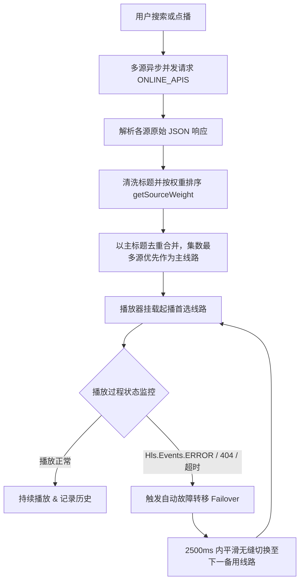

# 极光影院 (Aurora Player) API 接口与数据源集成规范

## 1. 外部数据源与采集接口概览 (Summary Table)

| 数据源名称 | 协议类型 | 默认接口地址 | 响应速度 (ms) | 默认权重 | 优势特色与支持特性 |
| :--- | :--- | :--- | :---: | :---: | :--- |
| **虎牙秒播线** | MacCMS V10 (JSON) | `https://www.huyaapi.com/api.php/provide/vod/` | 180ms ~ 280ms | 100 | 首屏直连起播、支持全网热播剧最新集数并发嗅探 |
| **光速高速线** | MacCMS V10 (JSON) | `https://api.guangsuapi.com/api.php/provide/vod/` | 220ms ~ 350ms | 90 | 多节点 CDN 分发，长视频、动漫与多集连续剧全量切片 |
| **红牛极速线** | MacCMS V10 (JSON) | `https://www.hongniuzy2.com/api.php/provide/vod/` | 260ms ~ 400ms | 80 | 影视院线电影与网络大电影片源覆盖全 |
| **新浪超清线** | MacCMS V10 (JSON) | `http://api.xinlangapi.com/xinlangapi.php/provide/vod/` | 320ms ~ 480ms | 70 | 蓝光超清母版、音轨纯净、码率高达 4000kbps |
| **量子蓝光线** | MacCMS V10 (JSON) | `https://cj.lziapi.com/api.php/provide/vod/` | 380ms ~ 560ms | 40 | 高清经典老剧、纪录片与小众高分片库储备丰富 |
| **非凡高速线** | MacCMS V10 (JSON) | `http://cj.ffzyapi.com/api.php/provide/vod/` | 420ms ~ 650ms | 30 | 全网备用容灾线路，支持兜底故障转移 (Failover) |
| **TVBox 生态源** | TVBox / JSON 规则 | 用户自定义导入 (本地持久化) | 动态并发测速 | 自定义 | 支持 TVBox 标准 JSON 规则生态无缝导入导出 |

---

## 2. API 接口规范与协议字段详细剖析 (Detailed Item Analysis)

### 2.1 MacCMS V10 标准聚合采集接口

#### 2.1.1 接口契约
* **请求方式**：`GET`
* **基础参数**：
  * `ac=detail`：拉取包含完整播放列表、集数 URL 与简介的详情信息；
  * `wd={keyword}`：根据影片名称进行模糊关键词检索；
  * `t={type_id}`：根据影视分类类别过滤；
  * `pg={page}`：分页拉取数据；
  * `h={hours}`：拉取最近指定小时内更新的影片（如 `h=24` 拉取今日更新）。

#### 2.1.2 请求示例
```http
GET https://www.huyaapi.com/api.php/provide/vod/?ac=detail&wd=九门 HTTP/1.1
Host: www.huyaapi.com
User-Agent: AuroraPlayer/2.0 iOS
Accept: application/json
```

#### 2.1.3 响应数据结构 (JSON)
```json
{
  "code": 1,
  "msg": "数据列表",
  "page": 1,
  "pagecount": 1,
  "limit": "20",
  "total": 1,
  "list": [
    {
      "vod_id": 98520,
      "vod_name": "九门",
      "vod_sub": "九门提督传说",
      "vod_class": "悬疑,动作,古装",
      "vod_pic": "https://vcover-vt-pic.puui.qpic.cn/vcover_vt_pic/0/mzc002001bk7moh1788430209093/260",
      "vod_remarks": "更新至30集",
      "vod_year": "2025",
      "vod_area": "中国大陆",
      "vod_hits": 172,
      "vod_play_from": "hym3u8$$$gsm3u8",
      "vod_play_url": "第01集$https://cdn.example.com/hls/ep01.m3u8#第02集$https://cdn.example.com/hls/ep02.m3u8$$$第01集$https://cdn2.example.com/ep01.m3u8"
    }
  ]
}
```

---

### 2.2 播放地址解析协议与线路提取算法

#### 2.2.1 格式特征
MacCMS 标准输出的 `vod_play_from` 与 `vod_play_url` 采用多层分隔符复合结构：
* **线路分隔符**：`$$$`，表示不同的播放源站/供应商线路；
* **集数分隔符**：`#`，表示当前线路下的不同分集；
* **标题与流分隔符**：`$`，左侧为剧集展示名称（如 `第01集`），右侧为真实的 M3U8/MP4 媒体流直链。

#### 2.2.2 解析与规范化算法实现
```typescript
export function parseMacCmsPlayUrls(playFrom: string, playUrl: string, apiPrefix: string = ""): VideoSource[] {
  const fromList = (playFrom || "默认线路").split("$$$");
  const urlGroupList = (playUrl || "").split("$$$");
  const sources: VideoSource[] = [];

  for (let i = 0; i < fromList.length; i++) {
    const rawGroupName = fromList[i] || `线路 ${i + 1}`;
    const rawUrls = urlGroupList[i] || "";
    const episodes: Episode[] = [];
    const epParts = rawUrls.split("#");

    for (const part of epParts) {
      if (!part.trim()) continue;
      if (part.includes("$")) {
        const [epName, epUrl] = part.split("$");
        if (epUrl && epUrl.trim()) {
          episodes.push({
            name: epName.trim() || `第 ${episodes.length + 1} 集`,
            url: normalizeMediaUrl(epUrl.trim()),
          });
        }
      }
    }

    if (episodes.length > 0) {
      sources.push({
        sourceName: `${apiPrefix ? apiPrefix + " · " : ""}${rawGroupName} (${episodes.length}集)`,
        episodes,
      });
    }
  }
  return sources;
}
```

---

### 2.3 智能多源并发聚合与故障转移 (Failover)



---

### 2.4 TVBox 自定义规则源生态规范

支持用户通过设置界面一键导入标准 TVBox JSON 订阅，系统自动解析并进行全网并发网络测速（Ping）：

#### 格式规范
```json
{
  "version": 1,
  "updatedAt": 1792182000000,
  "sites": [
    {
      "key": "feifan",
      "name": "非凡资源专线 (4K/秒播)",
      "type": 1,
      "api": "https://cj.ffzyapi.com/api.php/provide/vod/",
      "searchable": 1,
      "enabled": true
    }
  ]
}
```
* **一键全网测速**：向各大源的根路径或探测路径发起 `fetch` 并记录耗时 `pingMs`，前端以延迟由低至高智能排布，保障播放稳定性。
