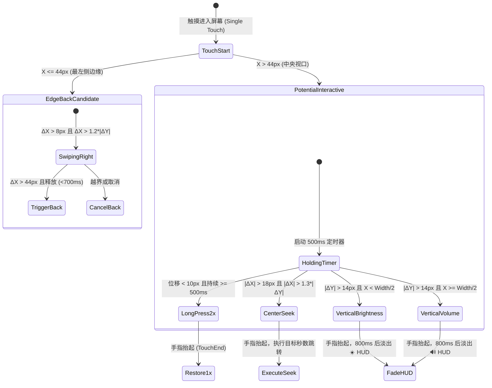
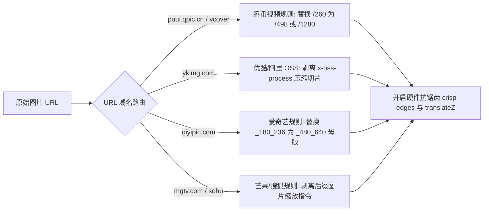
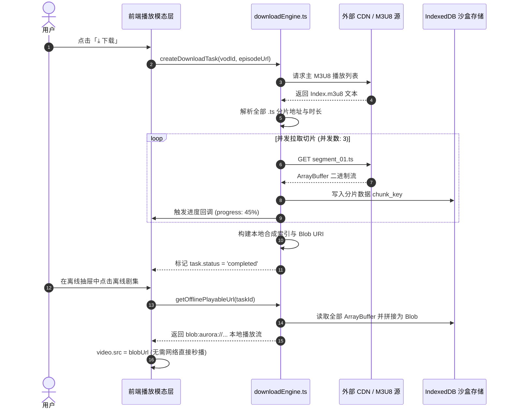

# 极光影院 (Aurora Player) 系统架构设计方案

## 1. 系统全景架构设计

极光影院（Aurora Player）采用 **iOS Native 宿主 + 自定义协议拦截 WKWebView + React 19 / TypeScript 现代化响应式前端 + HLS.js 跨源流媒体播放器 + 离线分片沙盒** 的复合跨端架构。该架构既拥有原生 iOS App 级别的视网膜渲染性能、AirPlay 投屏通道和硬件媒体控制能力，又具备 Web 技术栈敏捷迭代、样式 1:1 动态复刻与生态扩展的优势。

### 1.1 系统架构拓扑图

```mermaid
graph TD
    subgraph iOS_Host [iOS 原生宿主层 (SwiftUI / AVKit)]
        NativeApp[TempTestApp] --> ContentView[ContentView - 根视口]
        ContentView --> AuroraWebView[WKWebView 容器]
        AuroraWebView --> SchemeHandler[AuroraSchemeHandler (aurora:// 协议拦截)]
        SchemeHandler --> LocalBundle[App Bundle 内部静态资源 dist/]
        AuroraWebView -.系统通道.-> AVKitAirPlay[AirPlay 2 / MPVolumeView 硬件通道]
        AuroraWebView -.画中画.-> PiP[AVPictureInPictureController]
    end

    subgraph Web_Kernel [Web 渲染与交互内核 (React 19 + TypeScript)]
        AppRoot[App.tsx 全局状态机]
        AppRoot --> TouchGestureEngine[手势状态机调度器 (Gesture Engine)]
        AppRoot --> PortraitView[竖屏详情平铺流 (BagTrim 1:1 复刻)]
        AppRoot --> LandscapeView[横屏沉浸式全屏流 (原生 iOS 风格)]
        AppRoot --> NavDock[悬浮高斯模糊 Dock (4 Tabs)]

        TouchGestureEngine --> EdgeBack[边缘右滑返回 (X<=44px)]
        TouchGestureEngine --> CenterSeek[中央水平 Seek 预览]
        TouchGestureEngine --> LeftBrightness[左半屏垂直滑动 (☀️ 亮度调节)]
        TouchGestureEngine --> RightVolume[右半屏垂直滑动 (🔊 音量调节)]
        TouchGestureEngine --> LongPress2x[长按 500ms 触发 2.0x 极速快进]
    end

    subgraph Media_Pipeline [媒体流调度与解析管线]
        HlsEngine[HLS.js 流媒体加载引擎]
        HlsEngine --> FailoverManager[多源故障转移与超时监控 (Failover)]
        FailoverManager --> SourceAggregator[多源并发聚合搜索调度器]
        SourceAggregator --> MacCmsAPIs[MacCMS V10 采集源集群 (6 大线路)]
        SourceAggregator --> TVBoxCustom[TVBox 自定义源生态扩展]
        SourceAggregator --> HDMasterEngine[封面母版动态高清升级管线]
    end

    subgraph Storage_Layer [数据沙盒持久化层]
        IndexedDB[(IndexedDB - M3U8 切片沙盒)]
        LocalStorage[(LocalStorage - 偏好/追剧库/历史)]
        DownloadEngine[离线切片并发下载引擎] --> IndexedDB
        FavoritesSystem[追剧收藏与更新红点系统] --> LocalStorage
        HistoryManager[播放断点续播时间戳管理器] --> LocalStorage
    end

    AuroraWebView --> AppRoot
    AppRoot --> HlsEngine
    AppRoot --> Storage_Layer
```

---

## 2. 核心架构技术方案

### 2.1 突破 iOS 跨域与沙盒：`aurora://` 自定义协议拦截

#### 背景与挑战
在 iOS WKWebView 中，如果直接以 `file://` 协议加载本地单页应用（SPA），会受到 WebKit 严格的同源策略（CORS）与沙盒限制，导致无法发起外部 HTTP/HTTPS API 检索、无法拉取第三方 M3U8 切片流，且路由刷新会导致 404。

#### 核心技术方案
1. **协议注册**：在原生宿主通过 `WKWebViewConfiguration.setURLSchemeHandler` 注册自定义协议 `aurora://`；
2. **静态流拦截映射**：`AuroraSchemeHandler` 截获 `aurora://localhost/*` 请求，直接从本地沙盒 App Bundle 的 `dist/` 目录读取 HTML/JS/CSS/SVG，以标准 MIME 类型返回；
3. **CORS 放行与 SPA 容错**：在构造的 `HTTPURLResponse` 中显式注入 `Access-Control-Allow-Origin: *` 与 `Cache-Control: no-cache`；对于未能匹配到的子路径，自动重定向至 `index.html`。

```swift
class AuroraSchemeHandler: NSObject, WKURLSchemeHandler {
    let baseDirectory: URL
    func webView(_ webView: WKWebView, start urlSchemeTask: WKURLSchemeTask) {
        let relativePath = url.path.hasPrefix("/") ? String(url.path.dropFirst()) : url.path
        let targetFile = baseDirectory.appendingPathComponent(relativePath.isEmpty ? "index.html" : relativePath)
        if FileManager.default.fileExists(atPath: targetFile.path), let data = try? Data(contentsOf: targetFile) {
            let response = HTTPURLResponse(url: url, statusCode: 200, httpVersion: "HTTP/1.1", headerFields: [
                "Content-Type": mimeType(for: targetFile.pathExtension),
                "Access-Control-Allow-Origin": "*",
                "Cache-Control": "no-cache"
            ])!
            urlSchemeTask.didReceive(response)
            urlSchemeTask.didReceive(data)
            urlSchemeTask.didFinish()
        }
    }
}
```

---

### 2.2 触控手势状态机与多维交互隔离

手势交互引擎在移动端（尤其是大屏 iPhone 11 Pro Max）面临多重手势冲突（系统边缘返回 vs 播放器快进快退 vs 垂直亮度音量 vs 长按倍速）。架构采用严密的几何坐标与时间片判定状态机：



---

### 2.3 封面动态高清升级管线 (HD Master Image Pipeline)

针对国内主流视频平台（腾讯、优酷、爱奇艺等）默认下发低清移动端缩略图，在 iPhone 视网膜屏（@3x Retina）上呈现模糊颗粒的问题，构建了前端正则级母版转换拦截层：



---

### 2.4 离线沙盒存储与切片合成引擎 (Offline Download Engine)


