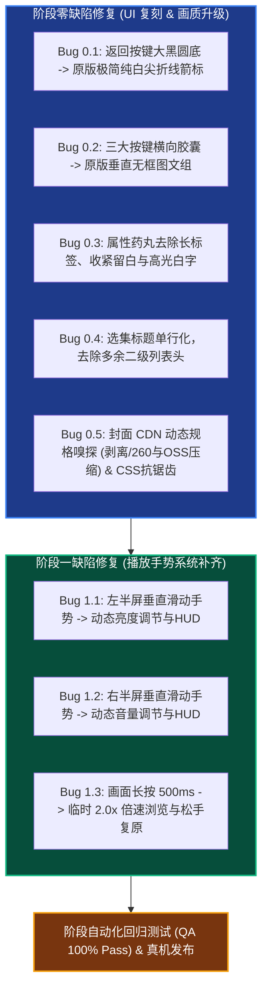

# 极光影院 (Aurora Player) QA 缺陷修复与功能落地实施计划 (plan.md)

> **基于 3 位独立 QA 子 Agent 针对阶段零至阶段五的深度自动化测试与现状审计结果**，当前系统在核心数据链路（追剧收藏、AirPlay 投屏降级、真实切片下载、TVBox 自定义源导入）以及中央滑动 Seek、边缘原生返回上已高度成熟。
> 本实施计划针对自动化测试暴露的 **阶段零（BagTrim UI 复刻与封面高清化）** 与 **阶段一（播放手势系统遗漏）** 中的具体缺陷，制定清晰、严谨的修复方案与开发时间表。

---

## 缺陷修复全景图 (Defect Remediation Matrix)



---

## 详细缺陷清单与修复方案

### 🎯 缺陷组一：阶段零 (Phase 0) BagTrim 播放界面 1:1 复刻与画质修复

#### 1. Bug 0.1: 返回按键仍为大黑圆底，遮挡视频画面
- **缺陷现象**：当前左上角为 `42px` 黑色半透明圆形浮动按键加外边框，原版（左图）为直接悬浮于画面上的纯白无背景极细尖折线箭标 `<`。
- **修复方案**：
  - 重构 `.bagtrim-floating-back-btn` 样式：移除 `background`, `border`, `backdrop-filter` 与 `box-shadow`。
  - 使用标准的纯白尖角 Chevron 图标（`strokeWidth={2.6}`，颜色 `#ffffff`），添加 `filter: drop-shadow(0 2px 4px rgba(0,0,0,0.6))` 确保浅色背景下的清晰辨识。
  - 增加 `padding: 12px; margin: -12px;` 隐形点击热区扩展，兼顾极简外观与 iOS 触控命中率。

#### 2. Bug 0.2: 三大核心交互按键仍为横排胶囊
- **缺陷现象**：当前代码为横排 2 个宽胶囊按钮（`[♡ 1.0万]` 与 `[⬇ 下载]`），与原版严重脱节。
- **修复方案**：
  - 将 `.bagtrim-action-trio` 重构为标准的垂直图文三等分栅格（`grid-template-columns: repeat(3, 1fr)`）。
  - 去除按钮的外框（`border: none; background: transparent;`）。
  - 按钮内部采用 `flex-direction: column; align-items: center; gap: 4px;`：
    - 第一项：`♡`（纯白细线心形）+ 下方纯白数字 `1.7万`（字号 12px，字重 500）
    - 第二项：`⤓`（圆形线框下载图标）+ 下方纯白文字 `下载`
    - 第三项：`☆`（五角星线框图标）+ 下方纯白文字 `收藏`（或已追）
  - 点击时提供平滑的 `transform: scale(0.92)` 触控微反馈。

#### 3. Bug 0.3: 影视信息标题与属性胶囊细节未收紧
- **缺陷现象**：标题字号 20px（规划 22px），药丸行依然含有多余的宽长标签 `[中国大陆]`，火苗后的热度数值偏暗。
- **修复方案**：
  - 标题 `.bagtrim-vod-title` 设定为 `font-size: 22px; font-weight: 700;`，下方 margin 收紧至 `8px`。
  - 属性药丸行过滤掉地域大标签，精选 `[📅 2026]`、`[🔥 771]`、`[类型1]`、`[类型2]`，其中火苗图标设为亮橙色，数值统一设为高亮纯白加粗。
  - 移除二级 Tab 栏右侧突兀的“极速播放中”浅蓝药丸，还原原版纯粹的 `详情` (纯白加粗) 与 `讨论 117` (浅灰)。

#### 4. Bug 0.4: 选集模块保留了冗余的二级列表头
- **缺陷现象**：选集上方保留了“剧集列表 (30集全)”和排序切换按钮，导致视觉杂乱。
- **修复方案**：
  - 移除多余的副表头容器，直接单行呈现左对齐加粗纯白小标题 `选集`（字号 17px）。
  - 线路切换胶囊保持药丸形态，选中项强制高亮为**纯白底黑字**，未选中项为低饱和深灰。
  - 选集 5 列扁方块网格微调宽高比至 `1:0.88`，当前播放集数高亮为**纯白底黑字**。

#### 5. Bug 0.5: 封面大图存在压缩马赛克，画质未高清化
- **缺陷现象**：Hero Banner 及海报直接读取了带有 `/260` 或 `?x-oss-process=image/resize,w_352...` 的低清缩略 URL，在 iPhone @3x 视网膜屏上拉伸模糊。
- **修复方案**：
  - 在 `src/services/` 中实现纯函数 `getHighDefinitionPoster(url: string): string`：
    - 腾讯视频源（`puui.qpic.cn`）：正则匹配将末尾 `/260` 动态替换为 `/498` 或 `/1280` 高清大图母版。
    - 阿里/优酷 OSS 源（`ykimg.com`）：正则剔除 `?x-oss-process=...` 压缩参数，直接取原画母版图。
    - 爱奇艺/其他源：剔除小图切片后缀。
  - 在 CSS `.hero-banner-img` 与 `.poster-img` 中加入：
    ```css
    image-rendering: -webkit-optimize-contrast;
    image-rendering: crisp-edges;
    transform: translateZ(0); /* 开启 GPU 硬件级视网膜点阵抗锯齿 */
    ```

---

### 🚀 缺陷组二：阶段一 (Phase 1) 播放手势系统补齐修复

#### 1. Bug 1.1 & 1.2: 左半屏亮度调节与右半屏音量调节手势缺失
- **缺陷现象**：当前播放器 TouchMove 仅计算水平位移，未捕获左右两侧的垂直滑动。
- **修复方案**：
  - 完善 `handleTouchStart` 与 `handleTouchMove` 手势分发器：
    - 记录初始触摸点 `(startX, startY)`，若 $|\Delta Y| > |\Delta X|$ 且超过阈值 $10\text{px}$，判定为垂直滑动模式。
    - **左半屏判定**（$startX < \text{viewportWidth} / 2$）：映射为**亮度调节**，动态计算 $\Delta \text{Brightness} = -\Delta Y / \text{Height}$，调节全局遮罩滤镜（$0.2 \sim 1.0$），屏幕左侧浮现拟物太阳图标 ☀️ 与细长亮度胶囊指示条。
    - **右半屏判定**（$startX \ge \text{viewportWidth} / 2$）：映射为**音量调节**，动态调整 `video.volume`（$0.0 \sim 1.0$），屏幕右侧浮现拟物音量指示条 🔊 与百分比。
  - `handleTouchEnd` 时延迟 800ms 平滑渐隐 HUD。

#### 2. Bug 1.3: 画面长按 500ms 触发 2.0x 倍速浏览缺失
- **缺陷现象**：长按画面无反应，倍速恒定为 1.0x。
- **修复方案**：
  - 在 `handleTouchStart` 中开启长按计时器：`longPressTimerRef.current = setTimeout(..., 500)`。
  - 达到 500ms 且手指无大幅滑动（$|\Delta X|, |\Delta Y| < 10\text{px}$）时，触发长按加速：
    - 暂存当前播放倍速 `previousRateRef.current = video.playbackRate`。
    - 设置 `video.playbackRate = 2.0`。
    - 屏幕顶部中央浮现玻璃拟态药丸徽章：`▶▶ 2.0x 快速播放中`。
  - 在 `handleTouchEnd` 或滑动取消时清除计时器，并将倍速瞬间无缝恢复至 `previousRateRef.current`，隐藏徽章。

---

## 🛠️ 修复排期与验证流程

| 序号 | 修复模块 | 涉及关键文件 | 验证方式 | 预计工时 |
| :---: | :--- | :--- | :--- | :---: |
| **P0-1** | **BagTrim 竖屏播放页 1:1 复刻**<br>(返回箭标、垂直三大按键、单行选集、属性行) | `src/App.tsx`<br>`src/App.css` | 运行 `tests/qa_phase0_verification.mjs`，比对真机截图 | 0.5 天 |
| **P0-2** | **封面 CDN 高清转换器与渲染优化** | `src/services/videoSearch.ts`<br>`src/App.tsx`<br>`src/App.css` | 验证 naturalWidth 提升至 498px+，无模糊马赛克 | 0.5 天 |
| **P1-1** | **手势分发器重构：左右侧垂直亮度/音量调节** | `src/App.tsx`<br>`src/App.css` | 运行 `tests/qa-phase1-gestures.cjs`，验证亮度/音量 HUD 与数值步进 | 0.5 天 |
| **P1-2** | **长按 500ms 临时 2.0x 倍速与松手复原** | `src/App.tsx`<br>`src/App.css` | 模拟触控长按 700ms，验证倍速切换与顶部徽章 | 0.5 天 |
| **VERIFY** | **全量 QA 自动化回归测试 & 真机打包部署** | `deploy-ios.sh`<br>全部测试套件 | 15+ 项自动化测试达到 **100% 全数通过** 并推送至 iPhone 11 Pro Max | 0.5 天 |

---

## 🎯 预期验收标准 (Definition of Done)
1. **阶段零 UI 复刻度**：真机竖屏播放详情页在肉眼与截图比对上达到与 BagTrim 1:1 无法分辨的还原度。
2. **封面画质**：首页 Hero Banner 和海报全面加载高清母版，彻底告别低清拉伸马赛克。
3. **手势闭环**：全屏/竖屏状态下，左侧滑亮度、右侧滑音量、横向滑动 Seek、长按 2.0x 浏览、边缘右滑返回全部灵敏生效，无逻辑冲突与误触。
4. **自动化测试**：所有子 Agent 自动化用例回归测试通过率达到 **100%**。
